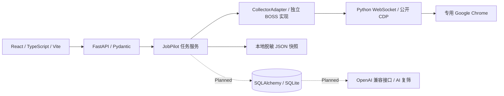

# JobPilot

**AI-Powered Job Search & Matching Assistant**

JobPilot 是基于 AI 的智能岗位检索与精准推荐系统，目标是提高岗位发现和筛选效率。完整 MVP 工作流为：

**BOSS 原生条件初筛 → 岗位与 JD 采集 → 数据库去重 → 基于简历、求职偏好和完整 JD 的 AI 复筛 → 推荐展示。**

目前处于 **MVP v0.1 / Phase 1（WIP）**：已实现 JobPilot 自有的 BOSS 列表与 JD 读取、基础 Web 页面和任务管理。数据库岗位存储、简历解析、AI 评分及推荐尚未实现。

## 当前采集方案

采集由 **JobPilot 自主实现的 Python CDP 客户端**执行，通过公开 Chrome DevTools Protocol 连接用户的专用 Google Chrome。当前运行不依赖 BossHunter、其本地 HTTP 服务或 Node.js CDP Runtime。

1. 用户在专用 Chrome 中手动登录 BOSS，设置关键词、城市等原生条件，打开搜索结果页。
2. 在 JobPilot 填写“读取几页 / 批次”，点击“开始读取”。
3. 系统读取当前列表，按需正常滚动加载后续批次，再串行打开岗位面板获取 JD。
4. 前端展示岗位字段、薪资、职位描述、任务进度和脱敏 DOM JSON，支持复制及停止。
5. 已有任务可点击“自动补齐本次 JD”：跳过已保存的 JD，继续处理未成功读取的岗位，不重新检索列表。

修改每日上限只修改配置，不会自动开始或恢复采集。“开始读取”会创建新任务；“自动补齐本次 JD”使用已有任务。列表分页目前不支持从中断页自动恢复。

## 实现状态与验证范围

| 能力 | 当前状态 |
| --- | --- |
| FastAPI / React / TypeScript 工程、健康接口 | 已实现 |
| 独立 CDP 连接、手动搜索页定位、列表读取 | 已实现，用户任务已保存 30 条真实岗位 |
| 正常滚动、批次计数、任务内链接去重 | 已实现，多种页面形态仍需验证 |
| 薪资专用字形还原、原始值保留 | 已实现，30 条真实记录验证 |
| 自动 JD、已有任务补齐、进度与停止 | WIP，真实任务已保存 4 条 JD，完整批次稳定性仍待验收 |
| JD 身份校验 | 已修复列表/详情标题后缀不同造成的误判；按岗位链接和选中卡片校验 |
| 每日额度配置、已用与剩余展示、开始前复核 | 已实现，修改上限不清空计数 |
| 格式化详情、原始 JSON、来源说明与复制 | 已实现 |
| SQLite 岗位存储、跨任务增量与去重 | Planned · Phase 2 |
| 简历、求职偏好、AI 复筛与多维评分 | Planned · Phase 3 |
| 推荐列表、评分解释及完整任务管理 | Planned · Phase 4 |

当前本机 `pytest` 为 **74 项通过**，前端 TypeScript 检查与 Vite 构建通过；离线浏览器验证覆盖真实 CDP 点击和异步面板更新。这些验证不代表所有 BOSS 页面均可稳定采集，开发检查不会自动进行多轮真实平台检索。历史私有样本不随仓库分发，缺少样本时对应测试会跳过。

## 技术架构



- 后端：Python 3.11、FastAPI、Pydantic、HTTPX、websockets。
- 前端：React、TypeScript、Vite；Node.js 用于前端开发和构建。
- 数据库与 AI：SQLAlchemy / SQLite、OpenAI 兼容 API 配置预留，业务为 Planned。
- 测试：pytest；协议和浏览器验证使用离线数据，真实采集由用户主动触发。

## 本地开发与启动

环境：Windows、Conda、Python 3.11、Node.js 22.12+、Google Chrome。当前项目目录为 `D:\Projects\JobPilot`，Conda 环境为 `D:\CondaEnvs\jobpilot`。

### 安装依赖

```powershell
cd D:\Projects\JobPilot
& D:\CondaEnvs\jobpilot\python.exe -m pip install -r backend\requirements-dev.txt
if (!(Test-Path .env)) { Copy-Item .env.example .env }
# 使用本机便携 Node 时先加入当前终端 PATH；普通 Node 安装可直接使用 npm。
if (Test-Path .tools\node\node.exe) {
    $env:Path = (Join-Path (Get-Location) '.tools\node') + ';' + $env:Path
}
npm.cmd --prefix frontend ci
```

`.env.example` 提供 CDP、后端、未来数据库和 AI 配置示例，AI Key 保持空值。当前采集无需配置或启动 BossHunter。

### 准备专用 Chrome

如果 `127.0.0.1:9222` 上已有专用 Chrome，直接复用。仅在没有实例时手动启动：

```powershell
& "C:\Program Files\Google\Chrome\Application\chrome.exe" --remote-debugging-port=9222 --remote-debugging-address=127.0.0.1 "--user-data-dir=D:\Projects\JobPilot\.chrome-profile"
```

在该窗口手动登录、设置搜索条件，并只保留一个 BOSS 搜索结果标签页。任务期间保持结果页不变，避免其他程序同时控制该浏览器。JobPilot 不启动或关闭用户 Chrome、不自动登录、不修改浏览器指纹。

### 启动前后端

终端一：

```powershell
& D:\CondaEnvs\jobpilot\python.exe scripts\start_backend.py --reload
```

终端二：

```powershell
powershell -NoProfile -ExecutionPolicy Bypass -File scripts\start_frontend.ps1
```

前端脚本使用 PATH 中的 npm 或项目自己的 `.tools/node`，无需其他项目目录。

- Web：[http://127.0.0.1:5173](http://127.0.0.1:5173)
- API 文档：[http://127.0.0.1:8200/docs](http://127.0.0.1:8200/docs)
- 健康接口：[http://127.0.0.1:8200/health](http://127.0.0.1:8200/health)

本地 HTTP 服务与 CDP 仅绑定 `127.0.0.1`。首次建议从 1 批开始，先查看每日剩余额度。

## 额度、数据与任务行为

**页数含义**：当前已加载的全部岗位算第 1 批，之后确认新增岗位链接才计入下一批，不保证每批固定条数。单次支持 1–20 批，仅在本任务内合并重复链接，尚无跨任务数据库去重。

**每日额度**：页面顶部可修改每日上限并保存，立即生效、重启保留；显示今日上限、已用及剩余，读取前再次复核。列表、手动刷新和自动打开 JD 共用计数，失败尝试也计数。初始值来自 `.env` 的 `COLLECTOR_DAILY_LIMIT`（默认 20）；前端保存的本地配置优先。按北京时间每日 00:00 换日，修改上限不清空已用记录。这是 JobPilot 本地预算，不是 BOSS 官方额度。

**原始信息**：`search_list_dom` 为列表 DOM 原文和节点结构，`detail_dom` 为职位描述面板，均不是 BOSS 内部网络 API 的原始 JSON。`salary_raw` 保留薪资原字符，显示值与核对依据单独保存；未知字体不猜数字。列表标题与详情标题允许不同，分别保留；岗位 URL 与已记录的选中卡片必须匹配，缺失字段不推断或补造。

**停止策略**：JD 串行读取、岗位之间至少间隔 3 秒，每个未打开岗位最多点击一次、等待匹配面板最多 12 秒。额度耗尽、验证/登录限制、页面变化、加载或身份匹配失败会停止并保留已有结果。重启不自动恢复任务。查看状态和额度不会自动启动采集，保存配置也不会自动重试失败任务。

主要本地接口：

| 接口 | 用途 |
| --- | --- |
| `POST /search/tasks` | 新建任务，仅接受 `{"max_pages":1}` |
| `GET /search/tasks/{id}` | 状态、进度、岗位及来源快照 |
| `POST /search/tasks/{id}/auto-details` | 补齐已有任务的 JD |
| `POST /search/tasks/{id}/stop` | 停止任务，保留结果 |
| `GET /search/budget` | 本地额度状态，不连接 Chrome |
| `PUT /search/budget` | 保存每日上限，如 `{"daily_limit":80}` |

## 目录结构

```text
backend/app/
  api/                   # 健康、任务、额度 API
  core/                  # 配置与脱敏
  integrations/
    boss_direct/         # 当前独立 CDP、DOM、薪资与身份校验
    bosshunter/          # 历史 HTTP 适配，当前任务不调用
  services/              # 当前任务编排及保留的历史服务
  schemas/               # 请求、任务与来源契约
  db/ models/            # 后续数据库业务预留
backend/tests/
frontend/src/            # 检索入口、额度、进度、详情与 JSON
docs/                    # 架构、路线图、字段分析
scripts/                 # 启动脚本、字体核对及历史工具
data/direct_tasks/       # 本地任务快照，Git 忽略
data/direct_collector/   # 本地配置、计数与互斥锁，Git 忽略
```

## 检查与 Roadmap

```powershell
& D:\CondaEnvs\jobpilot\python.exe -m pytest -q
npm.cmd --prefix frontend run build
```

字体字形核对辅助脚本 `scripts/verify_salary_font.py` 需要额外的 `fonttools[woff]` 和本地字体文件；应用启动不依赖该工具，字体文件不随仓库提交。

- Phase 0：工程、契约和采集接口验证。
- Phase 1（WIP）：原生条件检索、独立岗位/JD 采集、真实数据分析与稳定性验证。
- Phase 2（Planned）：SQLite 岗位存储、增量与跨任务去重。
- Phase 3（Planned）：简历、偏好、AI 智能复筛、多维匹配及解释。
- Phase 4（Planned）：推荐列表、排序、评分解释与完整任务管理。

详见 [架构说明](docs/architecture.md)、[路线图](docs/roadmap.md)、[字段与来源分析](docs/boss-data-analysis.md)。

## 安全、隐私与历史参考

不自动沟通、投递或发送简历；不绕过登录、验证码、频率限制或其他访问控制，不拦截安全资源。仅读取公开岗位区域，不读取 Cookie、Token、浏览器存储或个人聊天内容。URL 去除查询/片段，数据再次脱敏，原文作为文本展示。

`.env`、密钥、浏览器 profile、简历/上传文件、数据库、`data/`、`output/`、依赖及构建产物均被 Git 忽略。当前服务仅用于本机开发，不提供公网认证方案。

[BossHunter](https://github.com/shengjidaguai-china/BossHunter) 曾用于早期浏览器架构研究和对照验证。仓库保留的旧适配器、工具及字段分析属于历史方案；历史样本不作为当前任务结果，也不随 Git 分发。当前采集链路依据公开 [Chrome DevTools Protocol](https://chromedevtools.github.io/devtools-protocol/) 自主实现。使用历史适配工具时仍需遵守 BossHunter 原项目许可；JobPilot 自身许可证尚未选定。
