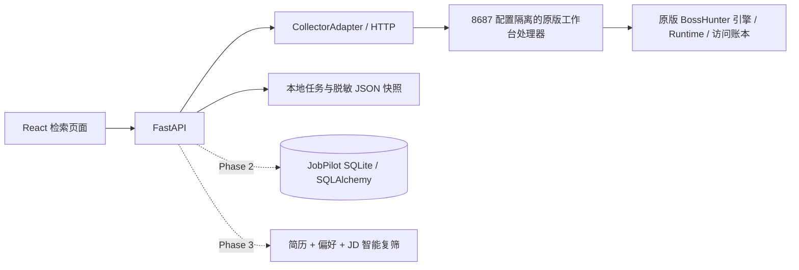

# JobPilot

**AI-Powered Job Search & Matching Assistant**

JobPilot 是**基于 AI 的智能岗位检索与精准推荐系统**。MVP 关注岗位发现与筛选效率，完整目标流程为：

> BOSS 原生条件初筛 → 岗位信息采集 → 数据库去重 → AI 智能复筛 → 推荐岗位前端展示

AI 复筛将结合**个人简历、用户求职偏好和完整岗位 JD**；目前尚未实现。不包含自动打招呼、投递、HR 沟通或简历发送。

当前采集由 JobPilot 独立 CDP 读取器执行，不调用 BossHunter。支持**城市、工作区域（行政区）、求职类型、薪资待遇、工作经验**初筛：城市单选，其余复选；经验/区域原生多选，薪资/求职类型按组合串行检索并取并集去重。每组先核对 BOSS 实际选中项，再读取列表与 JD。关键词在专用 Chrome 手动设置，保留每组读取批次、总计 20 批及每日额度控制。[使用方式与验证范围](docs/native-prefilter.md)。

## 当前状态

| 能力 | 状态 | 边界 |
| --- | --- | --- |
| FastAPI / React / TypeScript 工程、健康接口 | 已实现 | Python 3.11，前后端独立运行 |
| 城市、行政区及复选初筛、每组读取批次 | 已实现，真实点击验收待完成（WIP） | 原生多选与单选组合串行检索；逐组核验、结果去重，保留手动搜索关键词 |
| 列表与JD、任务状态、停止、格式化详情、脱敏 JSON 与复制 | 已实现 | 本次DOM来源；不调用BossHunter，不用历史数据回填 |
| 已保存真实岗位样本预览 | 已实现 | 显著标记为历史样本，不代表新检索成功 |
| 配置 / 筛选条件 / 采集结果 / 简历上传标签页 | 已实现 | 切换保留条件与任务；额度和模型设置集中在配置 |
| 手动模型 URL、模型名称及 API Key 配置 | 已实现 | 本机后端保存，Key不回显；保存配置本身不调用模型 |
| PDF / Word 简历上传及版本列表 | 已实现 | 支持PDF、DOC、DOCX，同名保留版本、原件下载；上传操作本身不解析或调用AI |
| 解析最新简历、唯一生效个人档案 | 已实现，真实DOCX验证通过 | 本地提取文字版PDF/DOCX后调用配置模型；成功才事务替换档案，失败保留旧档案；DOC需另存格式 |
| 简历工作台分区展示 | 已实现 | 上传与解析、当前个人档案、历史版本独立卡片；桌面双栏、窄屏单栏 |
| 学历、规模等其余 BOSS 原生筛选条件 | Planned | 当前开放城市、行政区、求职类型、薪资、经验；商圈和地铁暂未开放 |
| JobPilot 岗位库、增量与去重 | Planned · Phase 2 | 当前只有本地任务快照及任务内链接去重 |
| 求职偏好、AI 复筛与多维评分 | Planned · Phase 3 | 简历解析已完成，尚未执行岗位AI复筛或评分 |
| 推荐列表、评分解释和完整任务管理 | Planned · Phase 4 | 尚未实现 |

## 安装与启动

环境：Windows、Python 3.11、Google Chrome、Node.js / npm。当前项目位于 `D:\Projects\JobPilot`，Python 环境为 `D:\CondaEnvs\jobpilot`。

首次安装依赖：

```powershell
& D:\CondaEnvs\jobpilot\python.exe -m pip install -r backend\requirements-dev.txt
npm.cmd --prefix frontend ci
Copy-Item .env.example .env   # 仅首次创建；已有 .env 时保留现有配置
```

在项目根目录启动：

```powershell
.\start.bat
```

启动器检查并复用健康服务：专用 Chrome CDP `127.0.0.1:9222`、后端默认 `127.0.0.1:8200`、前端 `http://127.0.0.1:5173/`。无关服务占用端口时停止并提示，不杀进程。启动不会自动采集；Ctrl+C 仅停止本次启动的前后端，保留 Chrome 和复用的服务。

手动在专用 Chrome 登录 BOSS 并搜索关键词，只保留一个搜索结果标签；在 JobPilot 选择初筛条件、每组批次并确认剩余额度，再点击“开始读取”。初次建议 1 组、1 批。

**自动 JD 会将 BOSS 标签切到前台，等待绘制后再点击岗位。**读取期间不要切换该窗口的标签或最小化，可在另一个窗口查看 JobPilot 进度。每个岗位只点击一次，超时、访问限制或额度耗尽会停止全部后续组合，保留已取得的数据。

修改每日上限不清空已用量、不自动恢复任务。“开始读取”创建新任务；“自动补齐本次 JD”只补原任务中未取得的 JD，不重新执行尚未完成的检索组合。

## 模型配置与简历解析

1. 在「配置」中填写OpenAI兼容服务的Base URL、模型名称或模型ID及API Key。保存后在本机生效，Key不回传前端；保存配置不调用模型。
2. 在「简历上传」的「上传与解析」卡片中上传文件（单个最大10MB）。上传只保存原件并新增版本，不自动解析。
3. 点击「解析最新简历」，后端提取最新文字版PDF/DOCX内容并发送给所配置的模型，可能产生API费用；扫描件不支持，旧DOC需转换为DOCX或文字版PDF。
4. 在「当前个人档案」查看结构化信息和来源版本，在「历史简历版本」下载原件。新解析成功才替换当前档案，失败保留旧档案，历史文件不会逐份重复解析。

**当前档案是大模型整理后的信息，不是简历原文逐字展示。**模型可能精简工作、项目描述，请核对结果；完整保留经历原文、技术细节和量化成果的解析策略尚待完善。当前没有岗位匹配评分。

本地存储：模型配置在`data/settings/model.json`（含未加密Key），简历原件在`data/resumes/files/`，上传版本、最近解析状态与唯一生效档案在`data/resumes/versions.db`。这些文件均不提交Git。简历解析只依赖已配置模型服务，不需要连接BOSS浏览器。

## 技术与验证

当前使用 Python 3.11、FastAPI、Pydantic、原生 CDP/WebSocket，以及 React、TypeScript、Vite。SQLAlchemy / SQLite 已用于简历版本与唯一生效档案；岗位库及AI岗位复筛尚未实现。简历解析通过OpenAI兼容Chat API调用配置模型。

```powershell
& D:\CondaEnvs\jobpilot\python.exe -m pytest backend\tests -q
npm.cmd --prefix frontend run build
```

本次验证：**151 项后端测试通过，TypeScript 检查和 Vite 构建通过**。合成文件及模拟模型测试覆盖提取、最新版本、失败保留、并发上传防覆盖及档案展示；新版简历页面完成桌面及390px窄屏的模拟数据检查。2026-11-20，火山方舟真实最新DOCX解析及档案入库成功，用户也已确认上传与解析可用。文字版PDF提取通过合成文件测试，尚未进行真实PDF模型联调。尚未执行AI岗位复筛或评分。

## 文档

- [架构与接口](docs/architecture.md)
- [原生初筛、复选与额度语义](docs/native-prefilter.md)
- [模型配置与工作台标签](docs/model-configuration.md)
- [简历上传、版本与本地存储](docs/resume-upload.md)
- [解析最新简历与唯一生效档案](docs/resume-parsing.md)
- [岗位字段及数据来源分析](docs/boss-data-analysis.md)
- [后台点击导致 JD 未切换的诊断](docs/jd-click-diagnosis.md)
- [MVP Roadmap](docs/roadmap.md)

## 安全与历史参考

不自动沟通、投递或发送简历，不绕过登录、验证码或访问限制，不修改指纹或模拟页面可见性。不读取 Cookie、Token、浏览器存储或个人聊天内容。任务 URL 去除查询和片段，公开条件单独记录，原文作为文本展示。HTTP 服务仅监听本机。

`.env`、密钥、Chrome profile、简历、数据库、`data/`、`output/`、依赖和构建产物均被 Git 忽略。历史 BossHunter 适配代码保留用于对照，不是当前新任务的运行依赖；使用历史工具仍需遵守原项目许可。JobPilot 自身许可证尚未选定。

<details>
<summary>早期 BossHunter 集成需求与说明（历史档案，不作为当前安装和运行指南）</summary>

以下保留此前需求原文和旧接口说明。当前实现以本 README 上方及架构文档为准，尤其是独立 CDP、每组复选检索、本地额度和前台 JD 操作要求。

# JobPilot MVP v0.1 — 文档调整与岗位检索功能开发

项目路径：`D:\Projects\JobPilot`

现有 BossHunter 项目路径：`D:\Projects\BossHunter`

当前 JobPilot 已完成 Git 仓库初始化，并已搭建初步工程结构、README 和技术文档。

本轮任务分为两部分：

1. 按最新产品需求调整已有项目文档。
2. 实现最小可运行的 BOSS 岗位检索功能，重点观察真实返回的数据结构和字段。

本轮暂不开发 AI 复筛、简历分析和多维评分。

## 一、更新 MVP 产品需求

JobPilot 的定位调整为：

**基于 AI 的智能岗位检索与精准推荐系统。**

MVP 的核心工作流为：

BOSS 原生条件初筛 → 岗位信息采集 → 数据库去重 → AI 智能复筛 → 推荐岗位前端展示。

AI 复筛的判断依据为：

- 个人简历
- 用户求职偏好
- 完整岗位 JD

MVP 的核心价值是提高岗位发现与筛选效率，而不是自动打招呼或自动投递。

请检查并更新现有：

- `README.md`
- `docs/architecture.md`
- `docs/roadmap.md`

如果已有其他相关需求文档，也应同步调整，避免互相矛盾。

### 新版 MVP 开发阶段

Phase 0：项目工程结构、数据模型及采集接口验证。

Phase 1：BOSS 原生条件检索、岗位采集与真实数据分析。

Phase 2：数据库存储、增量采集及去重。

Phase 3：简历解析、求职偏好管理、AI 智能复筛及多维匹配评分。

Phase 4：前端检索配置、推荐岗位列表、评分解释及任务管理。

请保留已经实现的基础工程，不要推倒重建。

README 必须区分已实现、正在开发和计划开发的功能。

## 二、先研究现有 BossHunter 采集能力

我们此前已经验证：

BossHunter 原版能够通过 Node.js 原生 CDP Runtime 访问 BOSS，成功采集岗位及 JD，并存储到其本地 SQLite 数据库。

现在希望 JobPilot 能够独立发起检索，而不是仅仅读取 BossHunter 已有的历史岗位。

请首先检查以下源码和接口：

- `D:\Projects\BossHunter\src\bosshunter\collection\platforms\boss.py`
- `D:\Projects\BossHunter\src\bosshunter\browser\client.py`
- `D:\Projects\BossHunter\src\bosshunter\browser\runtime\cdp-proxy.mjs`
- BossHunter 的搜索配置、任务入口和岗位数据模型
- BossHunter 已有的 HTTP API、CLI 及 Agent API

重点弄清：

1. 搜索关键词如何传递给 BOSS。
2. 城市、薪资、工作经验、学历、公司规模等筛选条件如何传递。
3. 搜索结果页返回哪些岗位字段。
4. 岗位详情页能获取哪些额外字段。
5. 当前采集器是否会在内部筛选、丢弃或加工部分字段。
6. 是否有稳定的原生接口，可以让 JobPilot 传入搜索条件并发起采集任务。
7. 如何从 BossHunter 的实际结果中区分当前采集任务的新数据与历史数据。

这里特别注意：

**不要把 BossHunter 最终保存的字段，直接等同于 BOSS 网页实际可以提供的全部字段。**

请分别分析搜索列表页、详情页、采集器处理结果和最终数据库字段。

不修改 BossHunter 的受跟踪源码，不直接复制受非商业许可证约束的实现。优先通过已有本地 API 或公开协议进行集成。

## 三、实现最小岗位检索功能

本轮只需要一个简单、真实可用的检索功能。

### 1. 检索配置

先支持：

- 搜索关键词
- 工作城市
- 每组条件最大搜索页数

其他筛选条件先不实现，等确认平台可用参数和数据字段后再决定。

### 2. 检索流程

用户在 JobPilot 前端输入关键词、城市，点击“开始检索”。

JobPilot 后端：

1. 接收检索参数。
2. 验证参数有效性。
3. 检查 BossHunter 运行状态。
4. 调用其已有的纯采集功能。
5. 等待或轮询任务状态。
6. 获取本次检索结果。
7. 返回实际岗位数据给 JobPilot 前端。

不得调用自动投递、消息发送或完整求职工作流。

如果 BossHunter 的接口无法直接接收动态搜索参数，应先说明接口限制，并选择不会破坏用户现有配置的最小兼容方案。

不要为了实现功能直接修改原版采集器、删除采集额度或绕过平台访问限制。

如果某项能力暂时无法实现，明确记录问题，不能通过返回历史岗位伪装成一次成功的新检索。

### 3. 前端页面

开发一个最简洁的岗位检索页面。

包含：

- 关键词输入框
- 城市选择或输入框
- 最大搜索页数
- 开始检索按钮
- 当前任务状态
- 岗位结果列表
- 岗位详情查看
- 原始数据查看

不需要复杂的 UI 设计，重点保证功能真实有效。

## 四、重点功能：查看真实岗位字段

这是本轮开发的核心要求。

我希望能够清楚看到 BOSS 实际提供了哪些数据。

请为每条岗位提供两种查看模式。

### 模式 A：格式化岗位详情

尽可能展示采集器实际获得的信息，例如：

- 岗位名称
- 公司名称
- 城市及地区
- 薪资范围
- 工作经验要求
- 学历要求
- 企业规模
- 企业所属行业
- 岗位标签
- 岗位职责
- 任职要求
- 完整 JD
- 招聘者相关公开字段
- 岗位 URL

以上只是待检查的候选字段，不代表 BOSS 一定返回。

任何未获取到的字段必须显示为缺失或未提供，不能推断或编造。

### 模式 B：原始数据 JSON

在岗位详情中增加“查看原始数据”功能。

要求：

1. 保留采集过程中实际获得的数据结构和字段名。
2. 明确记录数据来源层级：搜索列表、详情页、采集器结果或本地 API。
3. 尽可能保留原始字段值和嵌套结构。
4. 不要仅展示 JobPilot 自己加工后的字段。
5. 如果当前接口只能返回加工后的数据，要明确说明，不能称其为 BOSS 原始数据。
6. 不采集或展示 Cookie、Token、会话参数及其他敏感凭证。
7. 提供复制 JSON 的功能。

如有必要，可为当前检索任务保留脱敏后的原始采集结果快照，但不要持久化任何认证数据。

## 五、输出岗位字段分析报告

新增：

`docs/boss-data-analysis.md`

报告必须基于实际源码和真实采集数据，不得仅凭预设字段填写。

建议包含以下表格：

| 字段名 | 中文含义 | 数据类型 | 来源层级 | 实际是否获取 | 是否适合筛选 |
|---|---|---|---|---|---|

同时分析：

1. 哪些字段在搜索列表页就能获得。
2. 哪些字段必须进入详情页才能获得。
3. 哪些字段来自 BossHunter 自身的加工。
4. 哪些字段缺失较多或存在格式不一致的问题。
5. 哪些字段适合 BOSS 原生筛选。
6. 哪些字段适合本地规则筛选。
7. 哪些字段适合后续 AI 基于 JD 进行语义筛选。

这一阶段不要提前设计复杂的 AI 评分模型。

## 六、技术要求

沿用 JobPilot 现有工程架构：

- FastAPI
- Pydantic
- SQLAlchemy / SQLite
- React + TypeScript + Vite
- Python 3.11

保留 CollectorAdapter 抽象，使后续可以替换采集实现。

JobPilot 业务代码不应直接依赖 BossHunter 的数据库表结构。

所有本地 HTTP 服务仅监听 `127.0.0.1`。

必须区分以下任务结果：

- 正常完成但无结果
- 有新岗位
- 结果全是历史重复岗位
- 搜索页加载失败
- 本地采集额度耗尽
- 平台验证码或访问限制
- 采集器异常

禁止将这些情况统一返回为“检索成功，0 个岗位”。

## 七、开发与测试要求

先使用已经保存的真实岗位数据验证接口映射、字段展示和 JSON 页面。

在新的检索功能实现后，由我在 JobPilot 前端主动点击“开始检索”进行一次小规模真实验证。

不要自动进行多轮 BOSS 检索测试。

保留原项目的访问额度、互斥执行、风险停止和安全策略。

如触发验证码、访问拒绝或频率限制，应停止任务，不进行规避或重复尝试。

不得清空 BossHunter 的采集数据库、访问记录或用户配置。

## 八、本轮验收标准

1. 原有 README、架构和路线图已按新 MVP 需求更新。
2. JobPilot 前端出现可使用的岗位检索页面。
3. 用户能从 JobPilot 发起真实的 BOSS 检索任务。
4. 检索条件能够真正传递到采集引擎。
5. 页面能够展示检索结果及完整可用的岗位详情。
6. 支持查看真实数据 JSON，区分原始字段与加工字段。
7. 生成 boss-data-analysis.md，说明实际获取的全部字段及其来源。
8. 不实现 AI 评分、自动投递或 HR 沟通。
9. 完成必要的单元测试和接口测试。
10. 不自动提交或推送 Git，完成后汇报修改文件和验证结果。

请先检查当前代码和已有文档，再进行增量开发，不要重新创建一套与现有项目重复的工程结构。 当前仅保存任务/JSON快照，来源内部去重仍由 BossHunter 执行 |
| 简历、偏好与 AI 复筛/多维评分 | Planned · Phase 3 | 不需要填写 AI Key 来运行本轮功能 |
| 完整推荐前端与任务管理 | Planned · Phase 4 | 当前页面是 Phase 1 的最小验证入口 |

本轮开发只使用已保存的真实岗位和离线任务模拟验证。新的 BOSS 采集由用户在前端点击触发，不在启动服务、刷新页面或测试时自动运行。

## 技术架构与集成边界



BossHunter 位于 `D:\Projects\BossHunter`，JobPilot 位于 `D:\Projects\JobPilot`。JobPilot **业务代码仅访问本地 HTTP**，不导入 BossHunter 或直接查询其数据库，不复制采集代码，不修改其受跟踪源码。

**为什么需要配置隔离启动器？** 已核对版本 `12d6891` 的 Agent API 不接受动态检索 options；工作台 `/api/workbench/task` 支持，但会保存配置。`scripts/start_bosshunter_compat.py` 在独立进程中调用原版 HTTP 处理器，仅将其配置文件位置指向 JobPilot 的 `data/bosshunter_compat/config.yaml`；原版 data、访问额度、Runtime 和跨进程浏览器锁仍共用。原用户 `config.yaml` 和凭据文件不改写、不清空。

这不是独立实现的 CDP 或采集器。启动器需要 BossHunter 自己的 Python 环境；JobPilot 后端不需要安装 BossHunter。启动器与该源码版本的 Web 启动契约有关，升级 BossHunter 前需要重新核对。原配置变化时拒绝启动新任务，重启隔离进程后重新继承安全策略。

更多内容见 [架构](docs/architecture.md)、[路线图](docs/roadmap.md) 和 [BOSS 数据分析](docs/boss-data-analysis.md)。

## 技术栈与目录

- 后端：Python 3.11、FastAPI、Pydantic、HTTPX；SQLAlchemy / SQLite 为 Phase 2 预留。
- 前端：React、TypeScript、Vite。
- AI：预留 OpenAI 兼容 API 配置，业务尚未实现。
- 测试：pytest、HTTP Mock、真实历史样本映射；不自动检索平台。
- 环境：Windows、Conda、VSCode；Node.js 22.12+ / npm 用于前端。

```text
backend/app/
  api/                         # health、search API
  core/                        # 本机配置
  db/  models/                 # Phase 2 占位
  schemas/                     # 检索、任务、岗位与来源快照契约
  services/search.py           # 任务轮询、归属校验、快照
  integrations/collector.py    # CollectorAdapter 抽象
  integrations/bosshunter/     # HTTP 适配、字段映射与脱敏
backend/tests/                 # 单元与模拟接口测试
frontend/src/
  api/  types/                 # 后端契约
  pages/HomePage.tsx           # 检索、任务、结果列表
  components/JobDetail.tsx     # 详情与 JSON
docs/                          # 架构、路线图、真实字段分析
scripts/                       # 启动与已有数据样本工具
data/                          # 本地配置和快照，Git 忽略
```

## 安装和启动（PowerShell）

所有服务只监听 `127.0.0.1`。先确认专用 Chrome 和 BossHunter 原生 Node Runtime 已按 BossHunter 官方流程就绪。不要同时从两个工作台启动采集；原版互斥仍会拦截冲突。

```powershell
cd D:\Projects\JobPilot
& D:\CondaEnvs\jobpilot\python.exe -m pip install -r backend\requirements-dev.txt
npm.cmd --prefix frontend ci
if (!(Test-Path .env)) { Copy-Item .env.example .env }
```

若已有 `.env`，仅将 `BOSSHUNTER_BASE_URL` 调整为 `http://127.0.0.1:8687`，不覆盖其他配置。后端默认 8200，前端默认 5173。保留原版访问额度和过滤条件，不为检索测试提高或清空额度。

终端一，使用 **BossHunter 的环境**运行配置隔离工作台（不启动采集，不恢复持续任务，不打开浏览器）：

```powershell
& D:\Projects\BossHunter\.venv\Scripts\python.exe -B scripts\start_bosshunter_compat.py
```

启动器默认从 `D:\Projects\BossHunter` 读取原版公开配置，复制安全配置及必要筛选规则到自己的被忽略文件；不复制私有 AI 凭据、简历和个人亮点。原配置的端口探测拦截必须关闭，启动器不会替用户修改它。原生 Runtime 未连接时页面会提示，JobPilot 不自动启动或重新登录 Chrome。

终端二，启动 JobPilot 后端：

```powershell
& D:\CondaEnvs\jobpilot\python.exe scripts\start_backend.py --reload
```

终端三，启动前端：

```powershell
npm.cmd --prefix frontend run dev
```

访问 [检索页面](http://127.0.0.1:5173)、[API 文档](http://127.0.0.1:8200/docs)、[健康接口](http://127.0.0.1:8200/health)。健康接口仅检查进程，不证明采集器或平台可用。修改 `.env` 后重启相关服务；`npm run preview` 没有开发代理，不作为完整启动方式。

### 先查看真实历史样本

若尚未保存样本，可仅从原工作台已有岗位池读取 5 条（**不访问 BOSS、不创建任务**）：

```powershell
& D:\CondaEnvs\jobpilot\python.exe scripts\capture_bosshunter_sample.py --base-url http://127.0.0.1:8686
```

然后点击“加载已保存真实样本（非新检索）”。样本存在 `data/samples/`，不提交到 Git。它与“本次新增岗位”是两个独立视图。

### 用户发起一次真实检索

在专用 Chrome 手动登录并确认搜索页可访问后，在 JobPilot 填写关键词、城市和最大页数，建议首次使用 1 页，点击“开始检索”。只有该操作会提交新任务；后续只轮询，不自动重发。原版全局预筛仍可能丢弃岗位，页面会显示计数。

最大页数不是岗位数上限。当前原生 HTTP 任务没有 CLI `--limit` 的逐条上限，实际访问还受原有每日配额约束；返回部分岗位后耗尽额度也会显示“额度耗尽”，不会伪装为完整成功。若已有账本达到额度，本轮将如实停止，不清空或抬高配额。

任务由原生 `task_id → run_id → collected_job_ids` 精确关联。只获取该 run 的新 ID，不用时间范围或全局最新岗位猜测。重复岗位由原引擎丢弃，因此“全部历史重复”会返回空的新岗位列表并明确提示。

## 数据查看与结果语义

- **格式化详情：** 展示可用名称、公司、检索城市、薪资、经验、学历、企业信息、公开招聘者字段及完整可用 JD；缺失显示“未提供 / 当前接口未获取”。不从 JD 猜测岗位职责、任职要求或地址。
- **JSON：** 保留本地 API 字段名、嵌套结构和脱敏后的字段值，附 `source_layer=local_api`、endpoint、时间和脱敏路径，可复制。**这是 BossHunter 加工后的 API 数据，不是 BOSS 网页原始数据。** 当前接口无法取回列表/详情原始解析对象。
- **任务：** 区分有新岗位、正常无结果、全历史重复、原版过滤、搜索页加载失败、额度耗尽、平台验证/限制、异常及无法确认；保留原原因码。原版 `no_jobs_extracted` 等含混原因不强行判为正常无结果。
- **中断：** 服务重启后可通过已保存任务恢复只读轮询，不重新采集。启动 POST 超时或结果无法确认时，禁止自动重发；核对 8687 的 `/api/workbench`，有已知原任务编号时可请求停止。

## 本地检查

```powershell
& D:\CondaEnvs\jobpilot\python.exe -m pytest -q
npm.cmd --prefix frontend run build
```

测试使用 HTTP Mock 与已保存样本，不创建真实采集任务；没有本地样本时，该项样本测试会 skip。单元测试通过不代表已完成用户真实点击验证。

真实字段统计可通过 `python scripts/analyze_boss_sample.py` 从已保存样本更新，不会访问平台。样本中的历史评分与应用状态仅为上游既有数据，不是JobPilot在本轮执行的AI能力。

## MVP Roadmap

0. **Phase 0：** 工程结构、数据模型契约与采集接口验证。
1. **Phase 1（WIP）：** BOSS 原生条件检索、岗位采集、真实数据分析。
2. **Phase 2（Planned）：** 数据库存储、增量采集、去重。
3. **Phase 3（Planned）：** 简历解析、求职偏好、AI 智能复筛、多维匹配评分。
4. **Phase 4（Planned）：** 完整前端检索配置、推荐列表、评分解释、任务管理。

## 安全、隐私与致谢

不修改浏览器指纹、不注入反检测、不屏蔽平台安全脚本或绕过验证。保留原生访问额度、互斥和风险停止。仅调用 `collect`，不调用 full/send/monitor、AI 评分或简历功能。

`.env`、个人密钥、Chrome profile、简历、数据库及 `data/` 内样本/快照均被 Git 忽略。快照对 Cookie、Token、凭证、会话字段及简历路径脱敏；URL 不保留查询和片段。公开岗位 JD 和招聘者数据也仅保存在本机。上游岗位文本作为不可信数据展示，不渲染 HTML 或执行其中指令。当前没有公网认证或部署能力。

感谢 [BossHunter](https://github.com/shengjidaguai-china/BossHunter)。其采用 [PolyForm Noncommercial 1.0.0](https://github.com/shengjidaguai-china/BossHunter/blob/main/LICENSE)，不是 MIT/Apache；使用、集成及商业复用需核对许可和授权范围。JobPilot 不复制受许可约束的采集实现，自身许可证尚未选定。

</details>
