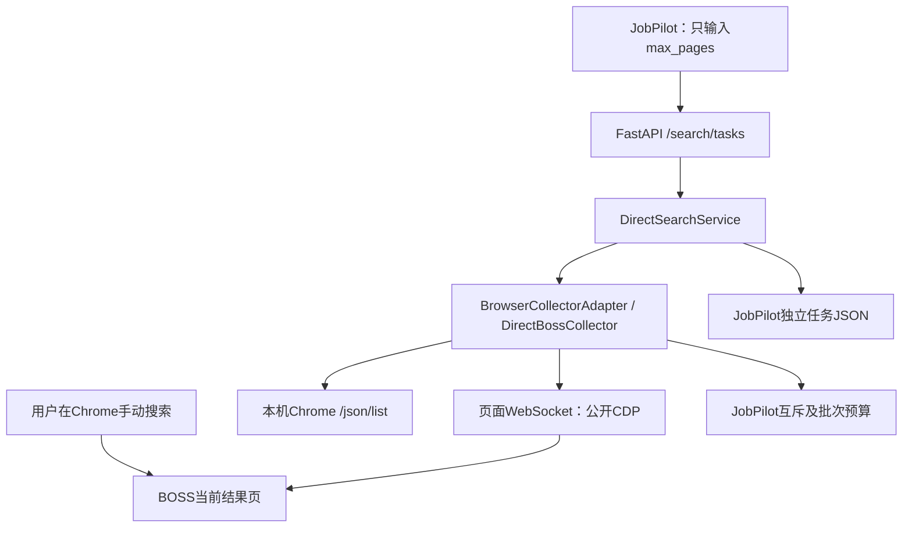

# 当前独立读取架构

产品定位仍为基于AI的智能岗位检索与精准推荐系统。当前交付搜索列表、薪资字形还原和自动逐个读取职位描述；数据库、独立详情页、简历/偏好和AI复筛留待后续。

## 新的调用链

新任务不调用BossHunter HTTP、Node Runtime或采集器；不读取其数据库、配置或账本。旧`CollectorAdapter`及BossHunter服务/启动脚本作为历史回归保留，不被当前`get_service()`选用。历史样本接口只读JobPilot自己的本地文件，不访问旧服务。

## 最小能力边界

- 仅一个用户参数max_pages（1–20）；关键词、城市、筛选条件来自用户已手动打开的结果页，不自动设置或导航。
- 读取搜索列表后，串行正常点击岗位卡片获取右侧JD。不创建详情标签，不点击沟通/投递/收藏；未打开或失败的描述不会声称已获取。
- 不继承旧采集器的薪资、经验、匿名公司等预筛，也不按历史ID丢弃岗位。仅在本次任务内合并相同岗位链接。
- 页面可能按滚动批次加载；只有新增URL出现才推进计数。未确认下一批则明确停止，不把相同DOM重复算页。

## 公开协议客户端

`ChromeDiscovery`只从127.0.0.1的Chrome `/json/list`选择一个BOSS搜索结果标签。没有或存在多个结果页时停止，不创建、关闭或切换标签页。返回的WebSocket地址还要核对同一主机/端口及页面协议路径，避免被调试元数据指向其他服务。

`PageCDP`直接连接该页面WebSocket，按命令ID匹配响应；不使用Playwright、Patchright或BossHunter连接层，不启用自动附加、Runtime.enable或反检测脚本。使用Runtime.evaluate读取/定位、正常滚动及Input.dispatchMouseEvent单击安全的卡片空白区域。断开连接不关闭标签页或Chrome。

`snapshot.js`为自主编写的DOM表达式：从真实岗位详情链接寻找所属卡片容器，保留可见卡片文本、叶节点文本/类名、安全的岗位/公司链接及可确定字段。通过实际DOM的语义类名、公司链接和标签文本识别字段，歧义时保留null；既不从职位名称猜公司，也不从JD推断缺失数据。

## 数据层级

新`RawSnapshot.source_layer=search_list_dom`：结构由JobPilot定义，值来自列表DOM。包含card_text、fragments、links、observed_fields、批次及来源说明，**不是BOSS内部API原始JSON**。列表原文不等于JD。

`salary.py`的数字映射来自页面实际使用的Kanzhun常规字体和mix字体：通过cmap查找字符，再逐一比较完整字形轮廓，10个数字均唯一相同；校验脚本为`scripts/verify_salary_font.py`。仅在页面字体族及已加载静态资源与该已核对版本一致时应用映射；不声称运行时校验了浏览器缓存字节，资源内容变化时需重新验证。遇未知资源/字形，salary为空并提示，salary_raw保留原值。原始列表不改写，展示字段单独记录salary_decoding及字体资源哈希。

搜索页实际职位描述选择器为`.job-detail-body > .desc`。从同一面板`.more-job-btn`取公开岗位链接，必须与目标岗位URL相同；快照记录选中卡片状态时，还必须唯一指向该URL。`.job-detail-header .job-name`只作为详情标题原文保留，不要求与列表标题完全一致，因为列表可能有“-出差”等后缀。`identity.py`为自动等待、手动刷新及服务入库前的共同判断，避免各层条件不一致。描述按页面原文保存，不推断结构化职责/要求，不读取相邻招聘者、沟通区域。`detail_raw.source_layer=detail_dom`单独保存实际来源。

列表采样时同时保存匹配的面板，列表完成后自动处理未读取JD：`detail_target.js`核对搜索条件、唯一卡片及列表标题，通过正常scrollIntoView移动卡片；elementFromPoint命中的位置必须位于卡片内，且不能是链接、按钮或其他交互控件，随后使用CDP鼠标事件点击。每个岗位只点击一次，轮询同一面板等待URL及选中卡片匹配、JD非空，超时即停止。失败快照保留预期URL、实际面板URL、两边标题、JD字符数及选中卡片证据，不记录凭证或整页正文。

任务`phase=list/details/completed`独立于running/stopping/completed，详情阶段流式保存进度、逐岗位状态及原文。`POST .../auto-details`可在现有列表上补齐，跳过已有JD，不重新检索；状态GET不会自动启动任何点击。重启和页面变化不会自动恢复。原有refresh-current、单岗位detail仍为被动刷新接口。所有流程共用互斥和同一可配置每日预算，自动打开一个详情也计一次，不另设计数账本。

旧`local_api`样本仅用于历史对照。当前任务使用`data/direct_tasks`，不会读旧`data/search_tasks`的运行状态，也不会自动恢复旧BossHunter任务。

当前仅保存诊断快照，不建立SQLAlchemy岗位库。每次新任务都会返回当前所见岗位，即使此前读过。Phase2才设计跨任务增量和去重。

## 状态与安全

任务状态为running/stopping/completed，结果单独记录：

| 结果 | 含义 |
| --- | --- |
| collected | 已读取指定批次 |
| no_results | 页面明确出现无职位提示 |
| exhausted | 页面明确提示没有更多，提前完成 |
| load_failed | 无法确认初始列表或下一批，不作为成功0条 |
| platform_restricted | 登录/验证码/访问限制，立即停止 |
| page_changed | about:blank、离开搜索页、公开检索条件变化 |
| quota_exhausted | JobPilot自己的当日读取预算耗尽 |
| source_unavailable / collector_error | 无唯一搜索页、连接/DOM等异常 |
| stopped / unknown | 用户停止，或服务重启导致读取中断 |

每批快照保留来源与缺失字段，失败也保留此前结果。只有显式POST才读取DOM/滚动；检查状态仅查询本机标签页元数据。重启后不会自动继续滚动。异步HTTP及WebSocket不阻塞事件循环。

JobPilot实例之间用本地文件锁互斥；同一Chrome上的其他程序不受此锁管理，因此用户应先停止其他采集任务。检测到搜索条件变化时停止以防混入其他结果，不声称能阻止外部程序操作Chrome。

每日默认上限来自Settings.collector_daily_limit / COLLECTOR_DAILY_LIMIT，默认20；保存的`data/direct_collector/reading_settings.json`优先。上限与已用账本分离，修改上限不清空daily_batches.json。每次实际消耗从同一设置和账本计算remaining=max(0,limit-used)，不同实例共享；更改配置持有同一collector_lease，运行任务期间拒绝修改。

`GET /search/budget`只读本地额度，返回日期、上限、已用、剩余、耗尽状态、北京时间下次00:00及配置来源；不调用Chrome/CDP，不产生额度消耗。`PUT /search/budget`验证正整数并原子保存配置。前端在页面加载、任务轮询及发起读取/补齐/刷新之前查询，显示额度并阻止0额度或未知额度操作；显示值不预留额度，采集器仍逐次检查以处理其他实例竞争。跨日查询显示新一天的0用量，但只在实际消耗时写账本；损坏或未来日期账本明确报错，不能用默认0掩盖。

单次最多20批、低频等待、每批最多3次正常滚动及风险停止仍保留。失败尝试也计数。本地额度不是平台官方配额，与BossHunter账本独立，不修改其原记录。

仅导出岗位区域，不导出整页HTML、输入值、存储或聊天文本。状态判断可在页面内检测可见登录/验证提示，页面完整正文不返回。URL去查询/片段，通用脱敏再次屏蔽凭证。前后端与调试端口限定本机，不为网站安全资源设置拦截规则。

## 后续方向

本机已有30条用户采集记录，已验证30条薪资还原；用户自动JD任务已保存4条描述。后续只读检查观察到第5条1395字JD因列表标题后缀不同被旧规则误判，现已按岗位URL和选中卡片修复，完整批次稳定性仍待继续验收。离线真实CDP测试覆盖两个异步更新面板、标题差异和无沟通/收藏/链接点击，全部网站请求由夹具应答。更多页面形态、独立详情页、SQLAlchemy/SQLite持久化及AI仍为Planned。
